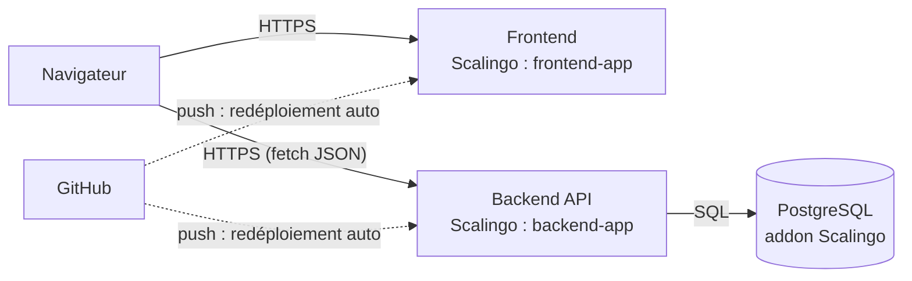

# Gestion de tickets — TP Mise en production & Hébergement

> TP Mise en production & Hébergement — YNOV — 19 novembre 2026

Application web permettant de déclarer un incident informatique, de consulter les tickets existants et de suivre leur résolution.

**Équipe :**

| Nom | Contribution |
|-----|--------------|
| Loïc SERVAJEAN | Mise en ligne |
| Nicolas CAILLOL | Documentation |
| Theodore NAJMAN | Dev |

## Liens utiles

| Élément | URL |
|---------|-----|
| Frontend | https://frontend-app.osc-fr1.scalingo.io/ |
| API | https://backend-app.osc-fr1.scalingo.io/api/tickets |
| Santé de l'API | https://backend-app.osc-fr1.scalingo.io/health |
| Dépôt GitHub | https://github.com/Loloroark/TP_creation_dapp |

## Architecture trois tiers



| Tier | Technologies | Hébergement |
|------|--------------|-------------|
| Frontend | HTML / CSS / JavaScript natif (sans framework), servi par un petit serveur Node.js 22 + Express 4. L'URL de l'API est transmise au navigateur via `/config.js`. | Scalingo (`frontend-app`) |
| Backend | Node.js 22, Express 4, `pg` (accès PostgreSQL), `cors`, `dotenv` (configuration locale) | Scalingo (`backend-app`) |
| Base de données | PostgreSQL | Addon PostgreSQL Scalingo |
| Code source | Git | GitHub |
| Déploiement | `Procfile` dans chaque dossier, redéploiement automatique à chaque push | GitHub → Scalingo |

## Fonctionnalités

Application complète : affichage, création et changement de statut des tickets, avec persistance en base.

Fonctionnalités facultatives réalisées :

- Supprimer un ticket (les identifiants des tickets restants sont renumérotés)
- Date de création affichée pour chaque ticket

## Modèle de données

Table `tickets`, créée automatiquement au démarrage de l'API (`backend/db/schema.sql`) :

| Champ | Type | Description |
|-------|------|-------------|
| `id` | `SERIAL` (entier auto-incrémenté), clé primaire | Identifiant unique |
| `titre` | `VARCHAR(200)`, obligatoire | Titre du ticket |
| `description` | `TEXT`, vide par défaut | Description de la demande |
| `statut` | `VARCHAR(20)`, `ouvert` par défaut | `ouvert`, `en_cours` ou `resolu` |
| `created_at` | `TIMESTAMP`, `NOW()` par défaut | Date de création |

Les statuts sont contrôlés par l'API **et** par une contrainte `CHECK` en base.

## API

| Méthode | Route | Rôle | Codes |
|---------|-------|------|-------|
| GET | `/health` | Vérifie l'API et la base | 200, 503 |
| GET | `/api/tickets` | Liste des tickets | 200 |
| POST | `/api/tickets` | Crée un ticket `{ titre, description }` | 201, 400 |
| PATCH | `/api/tickets/:id` | Modifie le statut `{ statut }` | 200, 400, 404 |
| DELETE | `/api/tickets/:id` | Supprime un ticket | 200, 400, 404 |

Les tickets sont renvoyés triés par identifiant croissant. Toutes les réponses sont au format JSON. Les erreurs renvoient `{ "error": "message" }`.

```bash
curl -X POST https://backend-app.osc-fr1.scalingo.io/api/tickets \
  -H "Content-Type: application/json" \
  -d '{"titre": "Imprimante en panne", "description": "Étage 2"}'
```

## Structure du dépôt

```
backend/    API Express (server.js, db/schema.sql, Procfile)
frontend/   Interface (public/) + serveur statique (server.js, Procfile)
```

## Lancer en local

Prérequis : Node.js 22, une base PostgreSQL.

```bash
cd backend
cp .env.example .env      # puis renseigner DATABASE_URL
npm install
npm start                 # http://localhost:3000
```

```bash
cd frontend
npm install
npm start                 # http://localhost:5173
```

## Déploiement sur Scalingo

1. Créer deux apps Scalingo liées au même dépôt GitHub.
2. **backend-app** : variable `PROJECT_DIR=backend`, ajouter l'addon PostgreSQL (crée `SCALINGO_POSTGRESQL_URL`), variable `CORS_ORIGIN=<URL du frontend>`.
3. **frontend-app** : variable `PROJECT_DIR=frontend`, variable `API_URL=<URL de l'API>`.
4. Activer le déploiement automatique sur la branche `main` : chaque push redéploie les apps.
5. Vérifier les logs et tester `/health`.


## Variables d'environnement

| App | Variable | Rôle |
|-----|----------|------|
| API | `SCALINGO_POSTGRESQL_URL` | Connexion à la base (créée par l'addon, jamais commitée) |
| API | `DATABASE_URL` | Connexion à la base en local (fichier `.env`) |
| API | `CORS_ORIGIN` | Origine(s) autorisée(s) à appeler l'API |
| Front | `API_URL` | URL publique de l'API, transmise au navigateur via `/config.js` |
| Les deux | `PORT` | Fourni automatiquement par Scalingo |
| Les deux | `PROJECT_DIR` | Sous-dossier à déployer (`backend` ou `frontend`) |

## Sécurité

- Aucun secret dans le dépôt : `.env` est ignoré par Git, seul `.env.example` (sans vraies valeurs) est versionné.
- Les identifiants de la base ne sont connus que du backend ; le frontend ne connaît que l'URL de l'API.
- Les entrées sont validées par l'API (titre obligatoire de 200 caractères maximum, description de 5000 maximum, statut parmi les trois valeurs, identifiant entier) et les requêtes SQL sont paramétrées.
- CORS limité à l'URL du frontend grâce à `CORS_ORIGIN` (sans cette variable, l'API accepte toutes les origines).
- Services exposés en HTTPS : toute requête HTTP est redirigée vers HTTPS.
- Les erreurs internes sont journalisées côté serveur, sans détail renvoyé au client.
