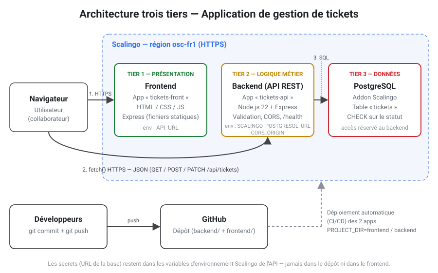

# Gestion de tickets — TP Mise en production & Hébergement (YNOV)

Application web permettant de déclarer un incident informatique, de consulter les tickets existants et de suivre leur résolution.

## Livrables

| Livrable | Emplacement |
|---|---|
| 1 — Documentation | Ce README |
| 2 — Application déployée | [URL publiques](#url-publiques) |
| 3 — Schéma d'architecture | [docs/architecture.svg](docs/architecture.svg) |
| 4 — Compte rendu technique | [docs/compte-rendu.md](docs/compte-rendu.md) |
| 5 — Démonstration orale | [docs/demo.md](docs/demo.md) (déroulé + checklist) |

## Architecture trois tiers



```
Navigateur ──HTTPS──▶ Frontend (Scalingo : tickets-front)
     │
     └──HTTPS (fetch JSON)──▶ Backend API (Scalingo : tickets-api)
                                   │
                                   └──▶ PostgreSQL (addon Scalingo)

GitHub ──push──▶ redéploiement automatique des deux apps
```

| Tier | Techno | Hébergement |
|---|---|---|
| Frontend | HTML / CSS / JS + petit serveur Express statique | Scalingo (`tickets-front`) |
| Backend | Node.js 22, Express, `pg` | Scalingo (`tickets-api`) |
| Base de données | PostgreSQL | Addon PostgreSQL Scalingo |
| Code source | Git | GitHub |

## URL publiques

- Frontend : _à compléter_
- API : _à compléter_ (santé : `/health`)

## API

| Méthode | Route | Rôle | Codes |
|---|---|---|---|
| GET | `/health` | Vérifie l'API et la base | 200, 503 |
| GET | `/api/tickets` | Liste des tickets | 200 |
| POST | `/api/tickets` | Crée un ticket `{ titre, description }` | 201, 400 |
| PATCH | `/api/tickets/:id` | Modifie le statut `{ statut }` | 200, 400, 404 |

Statuts autorisés : `ouvert`, `en_cours`, `resolu` (contrôlés par l'API **et** par une contrainte `CHECK` en base).

## Structure du dépôt

```
backend/    API Express (server.js, db/schema.sql, Procfile)
frontend/   Interface (public/) + serveur statique (server.js, Procfile)
docs/       Schéma d'architecture, compte rendu technique, démonstration
```

## Lancer en local

Prérequis : Node.js 22, une base PostgreSQL.

```bash
cd backend
cp .env.example .env      # puis renseigner DATABASE_URL
npm install
npm start                 # http://localhost:3000
```

```bash
cd frontend
npm install
npm start                 # http://localhost:5173
```

La table `tickets` est créée automatiquement au démarrage de l'API (`backend/db/schema.sql`).

## Déploiement sur Scalingo

1. Créer deux apps Scalingo liées au même dépôt GitHub.
2. **tickets-api** : variable `PROJECT_DIR=backend`, ajouter l'addon PostgreSQL (crée `SCALINGO_POSTGRESQL_URL`), variable `CORS_ORIGIN=<URL du frontend>`.
3. **tickets-front** : variable `PROJECT_DIR=frontend`, variable `API_URL=<URL de l'API>`.
4. Activer le déploiement automatique sur la branche `main` : chaque push redéploie les apps.
5. Vérifier dans les logs de l'API : `Base de données prête.` puis `API démarrée`, et tester `<URL API>/health`.

## Redéploiement automatique (CI/CD)

1. Modifier un élément visible (ex. : `v1` → `v2` dans le pied de page de `frontend/public/index.html`).
2. `git commit` puis `git push` sur la branche liée à Scalingo.
3. Scalingo lance automatiquement un nouveau build et déploiement (onglet *Deployments*).
4. Vérifier la modification sur l'URL publique du frontend.

## Variables d'environnement

| App | Variable | Rôle |
|---|---|---|
| API | `SCALINGO_POSTGRESQL_URL` | Connexion à la base (créée par l'addon, jamais commitée) |
| API | `CORS_ORIGIN` | Origine(s) autorisée(s) à appeler l'API |
| Front | `API_URL` | URL publique de l'API |
| Les deux | `PORT` | Fourni automatiquement par Scalingo |

## Sécurité

- Aucun secret dans le dépôt : `.env` est ignoré par Git, seul `.env.example` (sans vraies valeurs) est versionné.
- Les identifiants de la base ne sont connus que du backend ; le frontend ne connaît que l'URL de l'API.
- Les entrées sont validées par l'API, les requêtes SQL sont paramétrées.
- CORS limité à l'URL du frontend.
- HTTP redirigé automatiquement vers HTTPS sur les deux apps.
