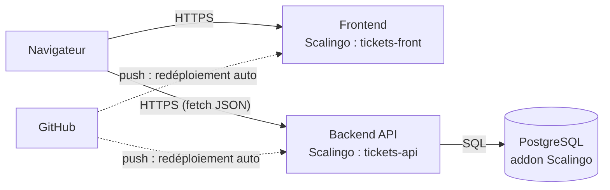

# Gestion de tickets — TP Mise en production & Hébergement (YNOV)

> TP Mise en production & Hébergement — YNOV — 19 novembre 2026

Application web permettant de déclarer un incident informatique, de consulter les tickets existants et de suivre leur résolution.

**Équipe :**

| Nom | Contribution |
|-----|--------------|
| _Loïc SERVAJEAN_ | _Mise en ligne_ |
| _Nicolas CAILLOL_ | _Documentation_ |
| _Theodore NAJMAN_ | _Dev_ |

## Liens utiles

| Élément | URL |
|---------|-----|
| Frontend | https://frontend-app.osc-fr1.scalingo.io/ |
| API | https://backend-app.osc-fr1.scalingo.io/ |
| Santé de l'API | https://backend-app.osc-fr1.scalingo.io`/health` |
| Dépôt GitHub | https://github.com/Loloroark/TP_creation_dapp.git |

> ⚠️ Sur les offres gratuites, un service inactif peut mettre quelques secondes à redémarrer à la première requête.

## Architecture trois tiers



Schéma complet : [`docs/architecture.png`](docs/architecture.png)

| Tier | Techno | Hébergement |
|------|--------|-------------|
| Frontend | HTML / CSS / JS + petit serveur Express statique | Scalingo (`tickets-front`) |
| Backend | Node.js 22, Express, `pg` | Scalingo (`tickets-api`) |
| Base de données | PostgreSQL | Addon PostgreSQL Scalingo |
| Code source | Git | GitHub |

**Justification des choix :** _à compléter (ex. une seule plateforme pour les trois tiers, addon PostgreSQL intégré, déploiement continu depuis GitHub, hébergement en Europe)._

## Fonctionnalités

- [x] F1 — Afficher les tickets (titre, description, statut)
- [x] F2 — Créer un ticket
- [x] F3 — Modifier le statut (Ouvert / En cours / Résolu)
- [x] F4 — Persistance des données
- [x] F5 — Application accessible en ligne

**Facultatives réalisées :** _à compléter (ou « aucune »)_

## Modèle de données

Table `tickets`, créée automatiquement au démarrage de l'API (`backend/db/schema.sql`) :

| Champ | Type | Description |
|-------|------|-------------|
| `id` | _à compléter (UUID / entier)_ | Identifiant unique |
| `titre` | _à compléter_ | Titre du ticket |
| `description` | TEXT | Description de la demande |
| `statut` | _à compléter_ | `ouvert`, `en_cours` ou `resolu` |
| `created_at` | TIMESTAMP | Date de création |

Les statuts sont contrôlés par l'API **et** par une contrainte `CHECK` en base.

## API

| Méthode | Route | Rôle | Codes |
|---------|-------|------|-------|
| GET | `/health` | Vérifie l'API et la base | 200, 503 |
| GET | `/api/tickets` | Liste des tickets | 200 |
| POST | `/api/tickets` | Crée un ticket `{ titre, description }` | 201, 400 |
| PATCH | `/api/tickets/:id` | Modifie le statut `{ statut }` | 200, 400, 404 |

Toutes les réponses sont au format JSON.

```bash
curl -X POST https://<url-api>/api/tickets \
  -H "Content-Type: application/json" \
  -d '{"titre": "Imprimante en panne", "description": "Étage 2"}'
```

## Structure du dépôt

```
backend/    API Express (server.js, db/schema.sql, Procfile)
frontend/   Interface (public/) + serveur statique (server.js, Procfile)
docs/       Schéma d'architecture, compte rendu technique
```

## Lancer en local

Prérequis : Node.js 22, une base PostgreSQL.

```bash
cd backend
cp .env.example .env      # puis renseigner DATABASE_URL
npm install
npm start                 # http://localhost:3000
```

```bash
cd frontend
npm install
npm start                 # http://localhost:5173
```

## Déploiement sur Scalingo

1. Créer deux apps Scalingo liées au même dépôt GitHub.
2. **tickets-api** : variable `PROJECT_DIR=backend`, ajouter l'addon PostgreSQL (crée `SCALINGO_POSTGRESQL_URL`), variable `CORS_ORIGIN=<URL du frontend>`.
3. **tickets-front** : variable `PROJECT_DIR=frontend`, variable `API_URL=<URL de l'API>`.
4. Activer le déploiement automatique sur la branche `main` : chaque push redéploie les apps.
5. Vérifier les logs et tester `/health`.

### Test de redéploiement (CI/CD)

_À compléter : modification effectuée, commit associé, déploiement observé, résultat sur l'application publique._

## Variables d'environnement

| App | Variable | Rôle |
|-----|----------|------|
| API | `SCALINGO_POSTGRESQL_URL` | Connexion à la base (créée par l'addon, jamais commitée) |
| API | `CORS_ORIGIN` | Origine(s) autorisée(s) à appeler l'API |
| Front | `API_URL` | URL publique de l'API |
| Les deux | `PORT` | Fourni automatiquement par Scalingo |
| Les deux | `PROJECT_DIR` | Sous-dossier à déployer (`backend` ou `frontend`) |

## Sécurité

- Aucun secret dans le dépôt : `.env` est ignoré par Git, seul `.env.example` (sans vraies valeurs) est versionné.
- Les identifiants de la base ne sont connus que du backend ; le frontend ne connaît que l'URL de l'API.
- Les entrées sont validées par l'API, les requêtes SQL sont paramétrées.
- CORS limité à l'URL du frontend.
- Services exposés en HTTPS.

## Problème rencontré et résolution

| Problème | Cause | Résolution |
|----------|-------|------------|
| _à compléter_ | _à compléter_ | _à compléter_ |

## Livrables

- [ ] Documentation (ce README)
- [ ] Application déployée (URLs ci-dessus)
- [ ] Schéma d'architecture (`docs/architecture.png`)
- [ ] Compte rendu technique (`docs/compte-rendu.md`)
- [ ] Démonstration orale